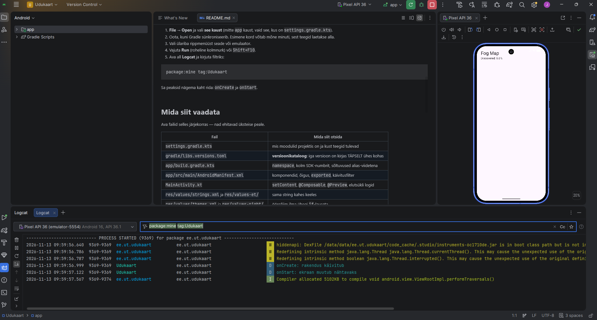
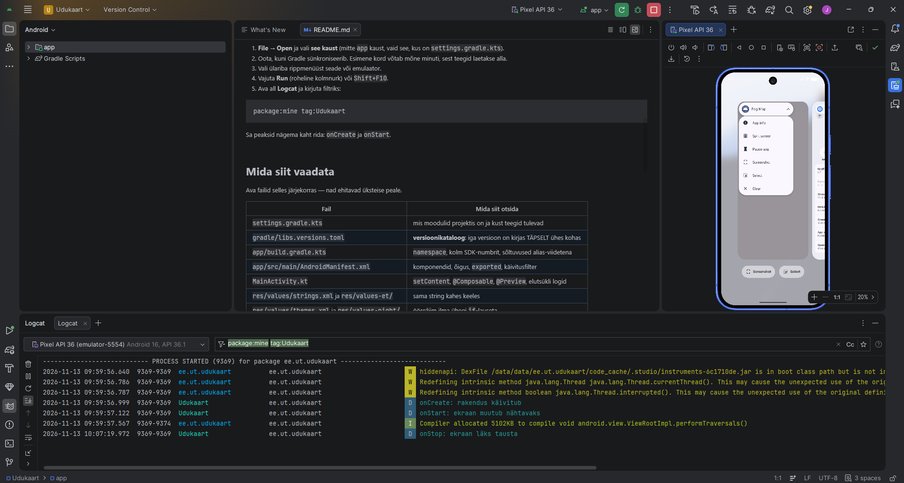
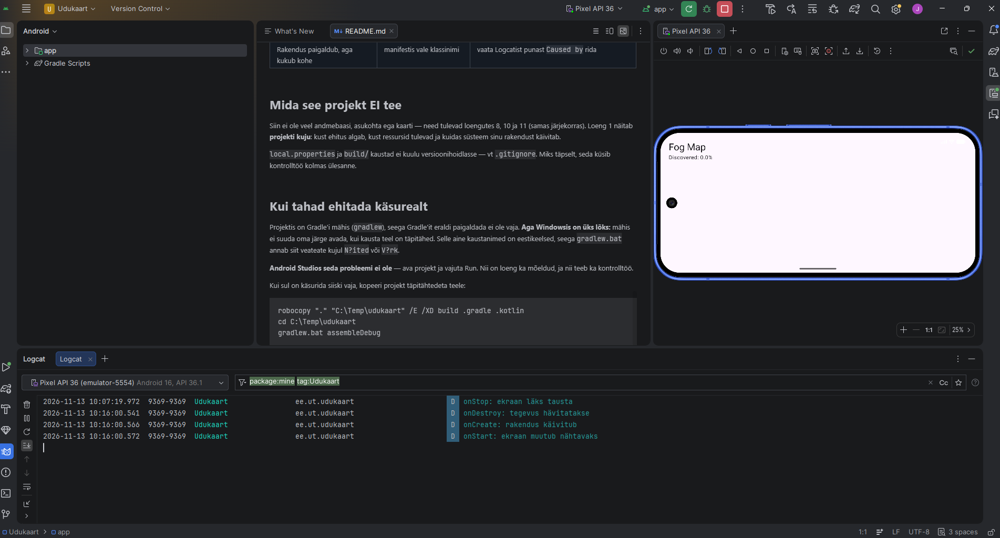
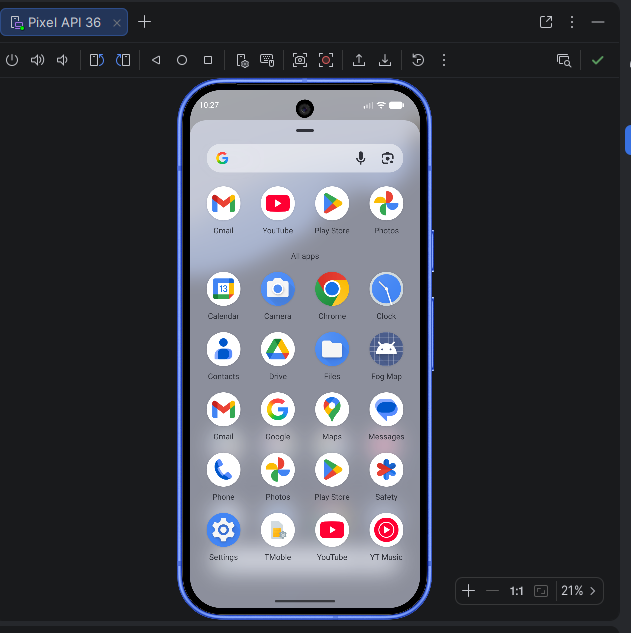
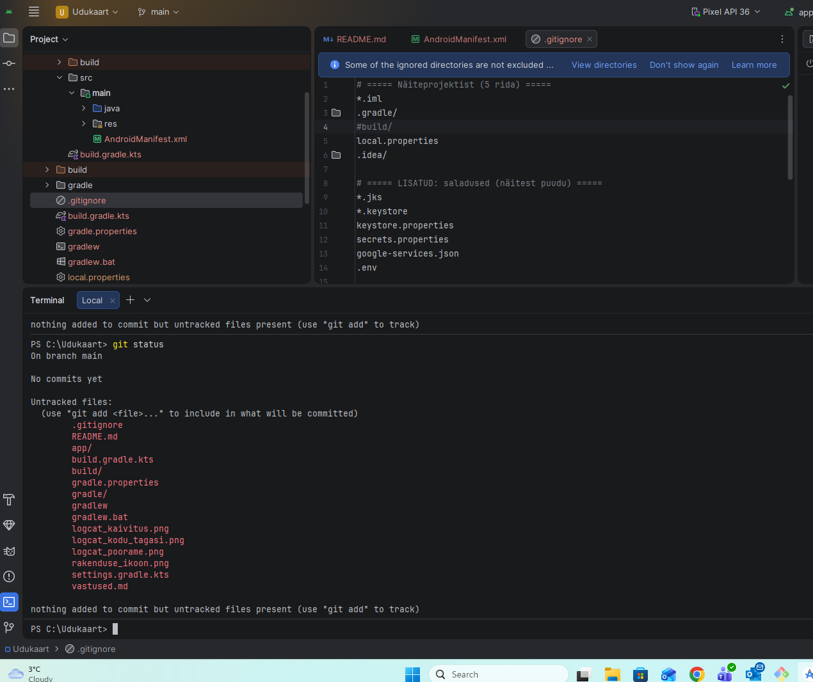
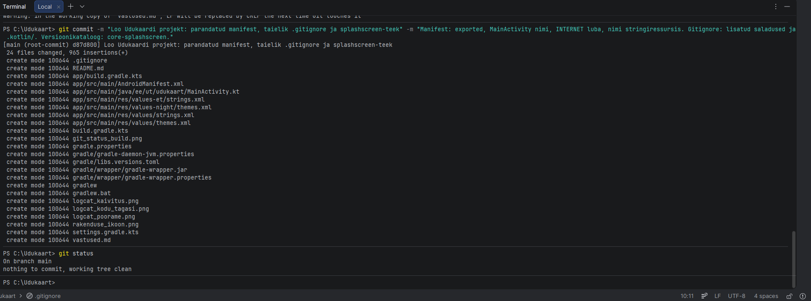

# Kontrolltöö 1 — Arenduskeskkond ja esimene rakendus

<!-- KUSTUTA SEE KOMMENTAAR ENNE ESITAMIST. Täida koht märgisega ✏️ (ülesanne 4). -->

## Ülesanne 1 — Elutsükkel Logcatis

Logcati filter: `package:mine tag:Udukaart` — nähtavad on ainult minu rakenduse read ja kõik kannavad sama silti.





Katsetatud emulaatoris (Pixel, API 36).

| Tegevus | Logis ilmuv järjekord |
| --- | --- |
| Rakenduse käivitamine | `onCreate: rakendus käivitub` → `onStart: ekraan muutub nähtavaks` |
| Koduekraani nupp | `onStop: ekraan läks tausta` |
| Tagasi rakendusse | `onStart: ekraan muutub nähtavaks` (`onCreate` EI ilmu) |
| Seadme pööramine | `onStop` → `onDestroy: tegevus hävitatakse` → `onCreate` → `onStart` |

Näiteprojekt logib ainult neid nelja meetodit (`onCreate`, `onStart`, `onStop`, `onDestroy`). Tegelikult kutsub süsteem vahel ka `onResume`, `onPause` ja `onRestart`, aga neid logis ei ole, sest `MainActivity` neid üle ei kirjuta.

**Miks `onCreate` teist korda ei ilmu.** Koduekraani nupu vajutamisel tegevust ei hävitata, see ainult peatatakse (`onStop`) ja jääb mällu alles. Tagasi tulles kasutab süsteem sama tegevuse eksemplari, seega pole vaja seda uuesti luua — kutsutakse ainult `onStart`.

**Mis juhtub pööramisel.** Pööramine on konfiguratsioonimuutus. Süsteem hävitab tegevuse (`onStop`, `onDestroy`) ja loob selle uue konfiguratsiooniga uuesti (`onCreate`, `onStart`), et laadida õiged ressursid (näiteks paigutus rõhtasendis). Kõik, mis on salvestatud ainult tegevuse muutujates, läheb kaotsi — sellepärast hoitakse olek hiljem ViewModelis või `rememberSaveable`'is.

**Teine juht, kus `onCreate` uuesti ilmub: protsessi surm.** Kui rakendus on taustal ja süsteemil jääb mälust puudu, tapab ta kogu protsessi. Kasutaja jaoks on rakendus endiselt „hiljutiste“ nimekirjas, aga tagasi tulles käivitatakse uus protsess ja tegevus luuakse uuesti `onCreate`'iga. Seda saab katsetada Android Studios nupuga *Terminate Application* või käsuga `adb shell am kill <pakinimi>`, kui rakendus on taustal.

**Miks logi ei tohi sisaldada isikuandmeid.** Logcati saab lugeda igaüks, kellel on seadmele USB-silumisega ligipääs, logid satuvad veaaruannetesse (bug report) ja krahhiaruannetesse ning lahkuvad nii seadmest kasutaja teadmata. Udukaardi puhul oleksid koordinaadid koos ajatemplitega jälgimisandmestik — neist on tuletatav kodu, töökoht ja harjumused. Isikuandmete logimine oleks ka GDPR-i rikkumine.

## Ülesanne 2 — Katkise manifesti parandus

| # | Viga | Millal avaldub | Parandus |
| --- | --- | --- | --- |
| 1 | Käivitataval tegevusel puudub `android:exported` | **Paigaldus**: alates Android 12-st (API 31) peab iga `intent-filter`'iga komponent selle välja ütlema, muidu paigaldus ebaõnnestub (`INSTALL_PARSE_FAILED_MANIFEST_MALFORMED`) | `android:exported="true"` — kanderakendus peab saama tegevuse käivitada |
| 2 | `android:name=".MainActivty"` — kirjaviga | **Käivitus**: klassi ei leita, rakendus kukub kohe kokku (`ClassNotFoundException`) | `.MainActivity` |
| 3 | Puudub `INTERNET` õigus | **Hiljem**: esimene võrgupäring (tänavavõrgu allalaadimine Overpass API-st, loeng 9) kukub `SecurityException`'iga | `<uses-permission android:name="android.permission.INTERNET" />` |
| 4 | `android:label="Udukaart"` on kõvasti sisse kirjutatud | **Hiljem**: nime ei saa tõlkida — rakendus näitaks igas keeles „Udukaart“; Android Studio lint hoiatab | `android:label="@string/app_name"` |

Parandatud manifest: [`app/src/main/AndroidManifest.xml`](app/src/main/AndroidManifest.xml)

Stringiressurss `app_name` on projektis juba olemas kahes keeles: `res/values/strings.xml` („Fog Map“) ja `res/values-et/strings.xml` („Udukaart“). Pärast parandust valib süsteem nime seadme keele järgi: ingliskeelses emulaatoris on rakenduste nimekirjas „Fog Map“, eesti keeles „Udukaart“. Kõvasti kirjutatud `label` jätaks selle võimaluse ära.



## Ülesanne 3 — Versioonihaldus

**Näite-`.gitignore`'i read ja põhjendused**

| Rida | Miks välja jäetud |
| --- | --- |
| `*.iml` | Android Studio / IntelliJ moodulifailid; IDE genereerib need Gradle'i failidest ise uuesti |
| `.gradle/` | Gradle'i kohalik vahemälu ja olekufailid projekti juures; masinapõhised |
| `build/` | Ehitustulemused (klassid, DEX, APK, genereeritud kood). Ilma kaldkriipsuta alguses kehtib see IGAS kaustas, s.t ka `app/build/` |
| `local.properties` | Minu masina SDK tee (`sdk.dir=...`) — teise arendaja masinas on see teine; Android Studio loob faili ise |
| `.idea/` | Android Studio isiklikud seaded (avatud failid, aknad) |

**Mis näitest PUUDUS — saladused**

| Rida | Miks |
| --- | --- |
| `*.jks`, `*.keystore` | Allkirjastusvõti. Lekkinud võtmega saab keegi teine avaldada minu nime all „uuenduse“; avalikust hoidlast ei saa lekkinud faili kunagi päriselt kustutada (see jääb ajalukku) |
| `keystore.properties` | Võtmehoidla paroolid ja võtme alias |
| `secrets.properties` | Google Mapsi API-võti (loeng 11) hoitakse väljaspool koodi |
| `google-services.json` | Firebase'i konfiguratsioon valikulise varundusmooduli jaoks (loeng 12) |
| `.env` | Keskkonnamuutujad ja muud saladused |

**Lisatud ka**

| Rida | Miks |
| --- | --- |
| `.kotlin/` | Kotlin 2.x (projektis 2.0.21) loob projekti juurde oma vahemälukausta — ilma selle reata ei oleks töökataloog pärast ehitust puhas |
| `*.apk`, `*.aab` | Ehitatud paketid, kui need satuvad väljapoole `build/` kausta (nt allkirjastatud väljalase eraldi kaustas) |
| `captures/` | Profileerija salvestised |
| `.DS_Store`, `Thumbs.db` | Operatsioonisüsteemi prügi |

**Hoidlasse JÄÄB:** `gradle/wrapper/` (muidu ehitavad teised teise Gradle'i versiooniga), `gradlew`, `gradlew.bat`, lähtekood, manifest, `build.gradle.kts` failid, `settings.gradle.kts`, `gradle/libs.versions.toml`, `res/` koos kvalifikaatoritega ja `.gitignore` ise.

**Katse: välistus ajutiselt välja.** Võtsin `.gitignore`'ist välja rea `build/`. `git status` näitas jälgimata failidena kausta `app/build/` (sadu faile). Pärast rea tagasipanemist kadusid need olekust.





**Esimene commit:**

```
Loo Udukaardi projekt: Compose'i mall, parandatud manifest ja .gitignore

- manifest: exported, õige tegevuse nimi, INTERNET õigus, nimi stringiressursis
- .gitignore: ehitustulemused, IDE failid, local.properties ja saladused välja
```

## Ülesanne 4 — Sõltuvus versioonikataloogi kaudu

Lisatud teek: `androidx.core:core-splashscreen` (käivitusekraani API, loeng 7). Kirje järgib kataloogi olemasolevat kuju: versiooni nimi camelCase'is, teegi alias `androidx-...`, viide `version.ref` kaudu.

`gradle/libs.versions.toml`:

```toml
[versions]
agp = "8.13.2"
kotlin = "2.0.21"
coreKtx = "1.15.0"
lifecycle = "2.8.7"
activityCompose = "1.9.3"
composeBom = "2024.11.00"
coreSplashscreen = "1.0.1"   # UUS

[libraries]
# ...olemasolevad kirjed...
androidx-core-splashscreen = { group = "androidx.core", name = "core-splashscreen", version.ref = "coreSplashscreen" }
```

`app/build.gradle.kts`:

```kotlin
dependencies {
    // ...olemasolevad sõltuvused...
    implementation(libs.androidx.core.splashscreen)
}
```

Versioon on kirjas ainult ühes kohas — `[versions]` plokis. Pärast Gradle Synci ehitus õnnestus. `minSdk` on tagasi `29` peal.

**Mis juhtus `minSdk = 34` juures.** Katsetasin kahe emulaatoriga: API 36 (Android 16) ja API 30 (Android 11). ✏️ Pärast `minSdk = 34` ja Synci märgiti API 30 emulaator seadmete rippmenüüs ühildumatuks (nimekirjast kadus __ seade); API 36 emulaator jäi alles. Need seadmed kasutavad Android 13 või vanemat (API < 34). `minSdk` on madalaim API tase, millele rakenduse saab paigaldada; kõik vanemad seadmed muutuvad ühildumatuks — Android Studio märgib need ja Play pood ei näita rakendust neile üldse.

**`compileSdk`, `minSdk` ja `targetSdk` vahe**

- `compileSdk` — mille SDK vastu koodi kompileeritakse; määrab, milliseid API-sid koodis kasutada saab. Mõjutab ainult ehitust.
- `minSdk` — vanim Androidi versioon, millele rakendus paigaldub. Vanemas seadmes rakendust ei ole.
- `targetSdk` — mille versiooni reeglite järgi rakendus käitub (õigused, taustapiirangud jne). Ütleb süsteemile „olen selle versiooniga testitud“. Play nõuab värsket väärtust (praegu 36).

Reegel: `minSdk ≤ targetSdk ≤ compileSdk`.

**Miks versioonikataloog on parem kui rida ehitusfailis.** Kõik versioonid on ühes failis; mitme mooduliga projektis kasutavad kõik moodulid sama teegi sama versiooni. Uuendamiseks muudetakse ühte rida. IDE pakub alias-viidetele automaatset täitmist ja kirjavead tulevad välja kompileerimisel, mitte alles ehitusel. Dependabot/Renovate oskavad faili automaatselt uuendada.

**Mida teeb BOM ja miks Compose seda kasutab.** BOM (Bill of Materials) on nimekiri teekide versioonidest, mis on omavahel koos testitud. Compose koosneb kümnetest teekidest (ui, material3, foundation, tooling…); BOM-i abil märgitakse versioon ainult BOM-ile ja üksikud Compose'i teegid lisatakse ilma versioonita. Nii ei saa kogemata segada näiteks `ui` ja `material3` ühildumatuid versioone.

```kotlin
implementation(platform(libs.androidx.compose.bom))
implementation(libs.androidx.ui)          // versioon tuleb BOM-ist
implementation(libs.androidx.material3)   // versioon tuleb BOM-ist
```

**Kui kaks moodulit nõuavad sama teegi eri versiooni.** Ühes APK-s saab olla ainult üks versioon. Gradle lahendab konflikti vaikimisi nii, et valib **kõrgeima** versiooni. Kui uuem versioon on API-d muutnud, võib madalamat ootav moodul käitusajal kokku kukkuda (`NoSuchMethodError`). Versioonikataloog hoiab ära, et selline konflikt üldse tekiks; vajadusel saab versiooni sundida (`strictly`, piirangud).

## Ülesanne 5 — Udukaardi ekraanikaart ja õigused

### Ekraanid

| Ekraan | Põhiülesanne | Võrguta? |
| --- | --- | --- |
| **Kaart** (peaekraan) | Näitab linna udukihiga, avastatud protsenti ja jälgimise olekut. | Osaliselt: udu, tänavavõrk ja protsent töötavad; Google Mapsi aluskaart vajab võrku (ametlikku offline-kaarti pole) |
| **Avastatud** | Näitab edenemist kogu linna ja linnaosade kaupa, lähedalasuvaid avastamata tänavaid ja kõndide ajalugu. | Jah, täielikult |
| **Album** | Näitab kõnni ajal tehtud fotosid ajajärjestuses ja kaardil koha järgi. | Jah (kaardivaate aluskaart vajab võrku) |
| **Seaded** | Linna valimine ja kustutamine, jälgimise täpsus, andmete eksport ja kustutamine, valikuline varundus. | Jah, välja arvatud linna allalaadimine ja pilvevarundus |

- **Jälgimise väljalülitamine:** Seaded (automaatne jälgimine sisse/välja). Ajutine paus ja „ära jälgi täna“ on lisaks ühe puudutusega Kaardi ekraanil.
- **Andmete eksport:** Seaded, biomeetrilise luku taga, koos valikuga „kustuta kõik minu andmed“.
- **Kaardi ligipääsetav alternatiiv:** tänavate nimekiri Avastatud-ekraanil — ekraanilugeja ei saa kaarti lugeda, nimekiri annab sama info teksti kujul.

### Õigused

| Õigus | Ekraan | Liik | Millal küsitakse | Põhjus kasutajale |
| --- | --- | --- | --- | --- |
| `ACCESS_FINE_LOCATION` (+ `ACCESS_COARSE_LOCATION`) | Kaart / Seaded | Käitusaegne | Kui kasutaja lülitab automaatse jälgimise sisse — mitte rakenduse esimesel käivitusel | „Udu hajub ainult seal, kus oled kõndinud. Tänava avamiseks on vaja täpset asukohta.“ |
| `ACCESS_BACKGROUND_LOCATION` ⚠️ **kõige rangem** | Seaded | Käitusaegne, **eraldi** | Alles PÄRAST esiplaani asukohaõigust, eraldi sammuna; Android 11+ suunab süsteemi seadetesse („Luba kogu aeg“) | „Rakendus tuvastab kõnni ise ka siis, kui telefon on taskus. Ilma selleta tuleks iga kõnd käsitsi käivitada.“ |
| `ACTIVITY_RECOGNITION` | Seaded | Käitusaegne (Android 10+), **eraldi õigus** | Koos automaatse jälgimise sisselülitamisega | „Nii eristame kõndi sõidust — autoga läbitud tänavaid ei avata.“ |
| `POST_NOTIFICATIONS` | Kaart / Seaded | Käitusaegne **Android 13-st** | Enne esimest salvestust (püsiteavitus) ja uue tänava teavitust | „Näeme alati, kas rakendus salvestab, ja anname teada uuest tänavast.“ |
| `CAMERA` | Kaart / Album | Käitusaegne | Kaamera nupu esimesel vajutusel | „Pildista ja seo foto kohaga kaardil.“ |
| `FOREGROUND_SERVICE`, `FOREGROUND_SERVICE_LOCATION` | — (taust) | Paigaldusaegne | — | Raja salvestus esiplaani teenuses, püsiteavitus nähtaval |
| `RECEIVE_BOOT_COMPLETED` | — (taust) | Paigaldusaegne | — | Pooleli salvestuse taastamine pärast taaskäivitust |
| `INTERNET`, `ACCESS_NETWORK_STATE` | Seaded | Paigaldusaegne | — | Linna tänavavõrgu allalaadimine, kaardiplaadid |
| `USE_BIOMETRIC` | Seaded | Paigaldusaegne | — | Biomeetriline lukk andmehalduse ees |

Fotode salvestamiseks meediakogusse eraldi salvestusõigust ei ole vaja (`minSdk` 29, ulatusega salvestus).

**Põhimõtted:** iga õigust küsitakse hetkel, mil põhjus on kasutajale nähtav; enne süsteemi dialoogi näidatakse oma selgitust; automaatne jälgimine on vaikimisi VÄLJAS ja lülitatakse sisse selgesõnaliselt.

### Kui kasutaja keeldub asukohaõigusest

- Rakendus **ei kuku kokku** ja jääb kasutatavaks: kaart koos seni avastatud alaga, Avastatud-ekraan, kõndide ajalugu, album ja seaded töötavad edasi.
- Kaardil on teavitusriba: „Ilma asukohata ei saa uusi tänavaid avada“ ja nupp, mis viib süsteemi seadetesse.
- Kui antakse ainult **ligikaudne** asukoht, öeldakse ausalt, et selle täpsusega tänavaid ei avata (kahtluse korral ei avata — F3.6).
- Kui keeldutakse ainult **taustaasukohast**, automaatne kõnni tuvastus ei tööta; kasutajale selgitatakse, mida ta kaotab.
- Püsiva keeldumise korral rakendus dialoogi enam ei näita, vaid ainult selgitust ja linki seadetesse.

### Kontroll projektikirjelduse privaatsuse peatükiga (7)

- ✅ Automaatne jälgimine on selgesõnaliselt sisse lülitatav, mitte vaikimisi sees
- ✅ Püsiteavitus näitab alati, kas rakendus salvestab (`POST_NOTIFICATIONS`, esiplaani teenus)
- ✅ Paus, „ära jälgi täna“ ja täielik väljalülitamine on ühe puudutuse kaugusel
- ✅ Andmehaldus (eksport, kustutamine) on biomeetrilise luku taga
- ✅ Andmed ei lahku seadmest: `INTERNET` on ainult tänavavõrgu ja kaardiplaatide jaoks; pilvevarundus on valikuline ja vaikimisi väljas
- ✅ Ühtegi õigust ei ole nimekirjas ilma põhjuseta
